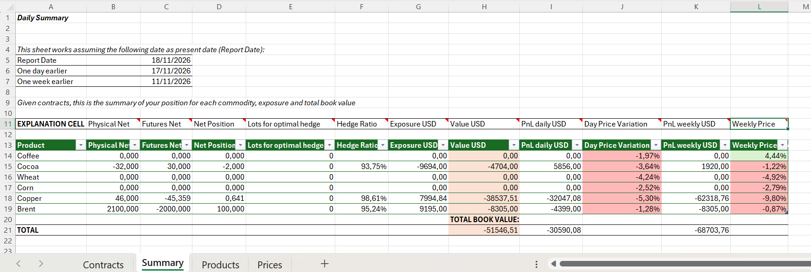

# Commodity Trading Book in Excel

An Excel workbook that values a small physical commodity trading book and its futures hedges:
enter contracts, and the Summary sheet shows net positions, hedge ratios, suggested hedge lots, value and daily and weekly P&L for each commodity.

Products covered: coffee, cocoa, wheat, corn, copper and Brent crude.

## How to use it

1. Download `MyTradingBook.xlsx` and open it in Excel.
2. In the **Contracts** sheet, add a contract in the first empty row: pick product, type
   (physical or future), direction and status from the drop-down lists, then type trade date,
   quantity and price. The unit to use is shown next to each input cell.
3. Open the **Summary** sheet to see the effect on the book.

Hover over the column headers for an explanation of each column.

## How it works

The workbook has four sheets:

| Sheet | Role |
|---|---|
| Contracts | The only input sheet: one row per contract |
| Summary | Positions, hedge ratio, value and P&L by commodity |
| Products | Contract specifications and unit conversions; today's, yesterday's and last week's prices |
| Prices | Daily closing prices of the front-month futures |

**Units:** Every market quotes in its own unit (US cents per pound for coffee, US cents per
bushel for grains, USD per pound for copper...). Each price is converted into USD per base unit
(metric tonne, or barrel for Brent) with a factor derived from a single constant,
1 lb = 0.45359237 kg. Bushels differ by grain: 60 lb for wheat, 56 lb for corn.

**Signed quantities:** Buys are positive, sells are negative, futures lots are converted into
tonnes or barrels. Closed or delivered contracts, and contracts dated after the report date,
count as zero.

**Valuation and P&L:** For each contract:

- Value = signed quantity x (market price today - contract price)
- Daily P&L = signed quantity x (market price today - starting price)
- Weekly P&L = same, with the price one week earlier as starting price

The starting price is the market price at the start of the period, or the contract price if
the contract was signed during that period, so new trades only show the P&L they actually made.

**Hedging:** Hedge ratio = - futures net / physical net. The workbook also suggests how many
futures lots to buy or sell to get as close as possible to a 100% hedge, rounded to whole lots.

## Data

Daily closing prices of front-month futures from Yahoo Finance
(KC=F, CC=F, ZW=F, ZC=F, HG=F, BZ=F), updated manually.

## Assumptions and limitations

- Futures are valued on the continuous front-month series, which jumps when the front
  contract expires (roll). 
- Physical contracts are valued at the futures price, with no physical premium or discount (basis).
- Contract prices are entered in the futures quote unit, even where physical trade usually uses
  another unit (e.g. USD/t for physical wheat).
- Closed and delivered contracts drop out of the book, so their realised P&L is not kept.
- All prices and values are in USD; no currency risk.

## Author

Fusu Cristian - MSc in Finance, HEC Lausanne - [linkedin.com/in/cristian-fusu-63a196351/]
